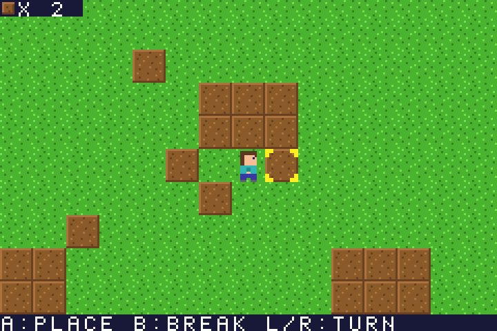

# Mini Minecraft GBA

A tiny Minecraft-inspired game for the **Game Boy Advance**, written in C.
Walk around a small grass island, break dirt blocks, collect them, and place
them to build things. Output is a real `MiniMinecraft.gba` ROM.



## Status (please read)

| Item | State |
|---|---|
| C source for the GBA | complete |
| Game logic tested on a PC against simulated GBA memory (`make test`, 300k-frame fuzz) | **passing** |
| Graphics checked with a software PPU (`make shots`, see `docs/*.png`) | **checked** |
| `MiniMinecraft.gba` compiled with devkitARM | **not done in the authoring environment** (no ARM toolchain, no network) |
| ROM run in mGBA / VBA / hardware | **not done** |

The ROM is built by `make` (devkitARM) or by the included GitHub Actions
workflow. The code uses only standard GBA registers and has no third-party
library dependency, but it has **not** been run on an emulator yet, so give it
a quick try after building and report anything odd.

## Controls

| Button | Action |
|---|---|
| D-pad | Walk (also turns to face that way) |
| A | Place a dirt block on the tile you face |
| B | Break the dirt block you face and collect it |
| L / R | Rotate the target direction without moving |
| START | Start / pause / resume |
| SELECT | Show / hide the controls bar |

The yellow brackets show the target tile. The top-left counter shows how many
dirt blocks you carry (max 99). Dirt is solid: break it to walk through.
Blocks can only be placed on empty grass, never on the player, and never on or
beyond the water border. The world is 24x20 blocks; the camera follows you.

## Building the ROM

### Option A - GitHub Actions (no install)
1. Push this folder to a GitHub repository.
2. Open the **Actions** tab, run **Build GBA ROM** (it also runs on every push).
3. Download the `MiniMinecraft-gba` artifact: it contains `MiniMinecraft.gba`.

### Option B - Docker
```sh
docker run --rm -v "$PWD":/work -w /work devkitpro/devkitarm sh -c \
  "dkp-pacman -Sy --noconfirm gba-tools && make"
```

### Option C - devkitPro installed locally
Install devkitPro (https://devkitpro.org/wiki/Getting_Started), then:
```sh
dkp-pacman -S gba-dev      # provides devkitARM + gbafix
make
```
Result: `MiniMinecraft.gba`.

### Running
Open `MiniMinecraft.gba` in mGBA, VisualBoyAdvance, or copy it to a flash
cart. (`gbafix` fills in the ROM header checksum that real hardware needs.)

## PC-side tests
Only needs `gcc` (and `python3` + `pillow` for screenshots):
```sh
make test     # rules: move, break, collect, place, boundaries, pause, fuzz
make shots    # renders title/play/pause/corner PNGs to build/shots
```
`tests/host_test.c` compiles the real `game.c`/`art.c` with `-DHOST_TEST`, which
swaps hardware memory for arrays. `tests/render.py` is a small software PPU.

## Project layout
```
include/gba.h        GBA registers and memory macros (no libtonc needed)
source/main.c        main loop + VBlank wait
source/game.c/.h     world, player, input, rendering, text/HUD
source/art.c/.h      all pixel art + font as ASCII art, VRAM loaders
tests/               PC-side tests and screenshot renderer
Makefile             devkitARM build (+ test targets)
.github/workflows/   CI build that produces the .gba artifact
```

## How it works (short)
* **Mode 0**, BG0 = world (64x64 tile map; each 16x16 block is 2x2 tiles),
  BG1 = text/HUD, sprites = player + cursor (16x16, 4bpp, 1D mapping).
* Art is ASCII strings (`'1'`..`'f'` = palette index) converted to 4bpp tiles at
  start-up, so there are no asset files. Edit the strings in `source/art.c`.
* World is a `u8 world[20][24]` grid; editing a block rewrites 4 map entries.
* Input is polled each VBlank; walking is grid-based with a 2 px/frame slide.

## Tweaking
* World size / layout: `WORLD_W/H` in `source/game.h`, `world_init()` in `game.c`
  (keep `WORLD_W*2 <= 64` and `WORLD_H*2 <= 64`).
* Walk speed: `MOVE_SPEED` (must divide 16).
* Colours: `art_load_palettes()` in `source/art.c`.
